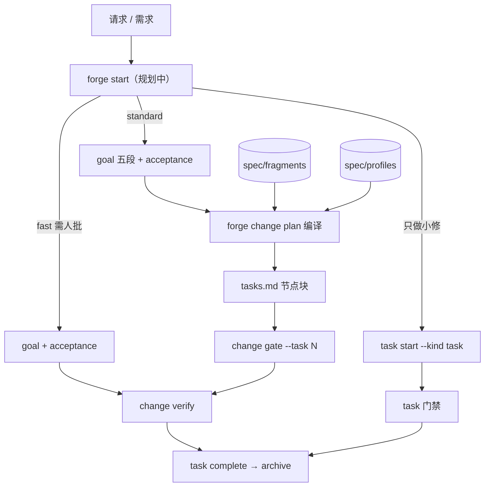

# 对齐 LoopSpec：计划可组合，执行仍确定性

状态：历史（设计草案，2026-11-15；R0 已在 1.87 交付，R1–R4 未拍板；文中的 `forge next` 决策表已随 core-only 简化）。

## 1. 问题

JustForMe 一天 9 个任务、0 个 change。agent 跑了 `forge next`，拿到的下一步是 `task start`——它没有违反规则，是 `forge next` 的决策表里没有 change（`internal/taskpipeline/next.go:58-64` 不读 `spec/changes/`，这是 R0 前的状态），而 `AGENTS.md` 硬规则又要求「只执行 next 给的下一步」。

LoopSpec 用两件东西防住这件事：

1. **入口问人**：`plan show`（含 digest）→ 停下等待 → 人 `plan approve --digest`；
2. **可组合零件**：Fragment（`fragment.yaml` + instruction/template/pass/fail）→ Profile（装配图）→ Plan（本次施工单，人批后冻结）。

Forge 两样都缺：change 只有固定五份文件，没有节点；入口不问人。

## 2. 对齐什么、不对齐什么

| | LoopSpec | Forge 目标 | 取舍理由 |
| --- | --- | --- | --- |
| 入口决策 | 展示 Plan + digest，等确认 | **问一次**：fast / standard / 只 task | 人只需要决定「走哪条」，不需要读施工单 |
| 可复用零件 | Fragment + Profile | **原样兼容**，加 `acceptance:` 绑定 | 不重造格式，直接吃 `loopspec-fragments` |
| 计划批准 | Plan digest 人批后冻结 | **不批**：plan 是派生物 | 真相源是 goal + acceptance + 代码；plan 可随时重建，批它就是多一次人往返和一条漂移面 |
| 节点执行 | 逐节点 `node instructions` + 手写报告 | 节点映射到 `tasks.md` 条目 + 围栏编号 | 沿用现有 `change gate --task N`，不新增报告文件 |
| 返工 | `plan rollback` 重置节点 | 重跑该节点判据；失败证据进 `priorAttempts` | 已有 priorAttempts，不引入 rollback 状态机 |
| 计划修订 | 写修订请求 + validate + approve | 改 tasks.md 即失效证据，重跑 | 少 2 次人往返 |

**耗时拆解**（LoopSpec 慢在哪，这是要避开的）：

- 每个 change：`new` → `fragment list/show` → 写 request → `plan validate`（常多次）→ `plan create` → `plan show` → 人工确认 → `plan approve`，≥7 条命令 + 1 次人往返；
- 每个节点：`node instructions` → 读 instruction/template → 写产物 → 写 PASS/FAIL 报告；
- 计划变化：重写 flow + 重新 validate + 重新 approve。

**Forge 的耗时预算**（写进验收判据）：

| 指标 | 目标 | 采集方式 |
| --- | --- | --- |
| 人往返 | ≤1 次/change（入口） | decision 日志 |
| 命令条数 | standard ≤8；fast ≤3；task-only ≤5 | checklog 时间戳 |
| 请求到首次编辑 | ≤2 分钟 | session 时间戳 |
| 节点 gate | 只跑该节点围栏 | `change gate --task` 输出 |

## 3. 设计：三层 + 一个入口

```text
        ┌─────────────── 人 ───────────────┐
        │  一次选择：fast / standard / task │  ← forge start（规划中，未实现）
        └───────────────┬──────────────────┘
                        ▼
  契约层（人负责，agent 起草，改了就重新批准）
    goal.md 五段 + acceptance 围栏
                        │
                        ▼
  组装层（机器推导，无人批准，可重建）
    fragments/ + profiles/ ──compile──► plan.md（节点 → tasks 条目 + 围栏编号）
                        │
                        ▼
  执行层（确定性）
    task 门禁 → change gate --task N（逐节点）→ change verify（全量）→ complete → archive
```

三条铁律：

1. **契约层只认人能读的两样**：goal 五段、acceptance 围栏。plan 不承载新语义。
2. **plan 是派生物**：`forge change plan --print` 任何时候可重建；改 `tasks.md` 或 fragment 只让证据失效，不要求重新批准。
3. **人只被问两次**：入口选通道；goal/acceptance 改动（后者沿用现有「改判据 = 重新验证」）。其余全自动。

## 4. Fragment 格式（兼容 LoopSpec，最小扩展）

```text
spec/fragments/<name>/fragment.yaml
  name: backend-tests
  nodes:
    - id: tests
      kind: artifact            # artifact | gate | assurance
      instruction: tests.instruction.md
      template: tests.template.md
      pass: tests.pass.md
      fail: tests.fail.md
      acceptance: [2, 3]        # forge 扩展：绑定 acceptance 围栏编号

spec/profiles/<name>.yaml
  name: standard
  flow:
    - fragment: requirements
    - fragment: backend-code
    - fragment: backend-tests
      requires: [backend-code]
    - fragment: backend-pr-review
      requires: [backend-tests]
```

编译规则：

- 一个 fragment 实例 = 一个 `tasks.md` 条目（自动生成块，标记 `<!-- forge:plan -->`），判据写 `（判据：acceptance #N）`；
- 节点没有 `acceptance:` 时，该节点是纯说明节点（不产生 gate），保留了 LoopSpec 的「产物节点」；
- profile 缺省时按 `standard`：requirements → code → tests → review；`fast` 不编译 plan。

## 5. 全景图



## 6. Roadmap

| 里程碑 | 交付物 | 验收判据 | 预估 | 依赖 |
| --- | --- | --- | --- | --- |
| **R0 入口决策**（已交付） | `next` 在「声明 spec + 脏树 + 无任务」时按 change 阶段给下一步；`task start` 随时可开，显式 `--change` 才校验 ready；`change phase` 推导缺什么 | 脏树里 agent 能被 `next` 引导；不带 `--change` 能开工；ready 的 change 能直接带 `--change` 开工；e2e 覆盖两条路 | 1–2 天（已完成） | 无 |
| **R1 fragment 编译** | `spec/fragments`、`spec/profiles` loader；`forge change plan`；`change gate --task` 读节点判据；`plan --print` | 用 `loopspec-fragments/backend-tests` 原样编译成功；三节点 change 逐节点过 gate | 3–5 天 | R0 |
| **R2 节点返工** | 节点失败 → 重跑该节点 → 证据进 priorAttempts；`plan` 漂移检测（tasks hash） | 一个节点故意失败两次，第三次修复后通过；代码未被回滚 | 3–4 天 | R1 |
| **R3 通道建议** | 按 diff 规模/文件数建议 fast/standard；`start` 默认值可配置 | 20 个历史任务回放：小修 90% 被建议 fast，大改 90% 被建议 standard | 2–3 天 | R0 |
| **R4（可选）fragment registry** | `forge fragment sync`（团队库）+ 本地覆盖 | 从 `loopspec-fragments` 同步一次，冲突可解析 | 3–5 天 | R1 |

R0–R2 是「对齐 LoopSpec 且更快」的最小闭环；R3 是省人往返；R4 是生态，不进本轮承诺。

## 7. 度量与验证

- 每个里程碑都跑同一组指标（§2 表），并与 JustForMe 今天 9 个任务的实际命令数对比；
- 留存基线：今天 9 任务 = 0 change、平均 4 条 gate 命令、1–2 次 override；R0 后同规模需求应变成「1 次 ASK + change 五份 + 节点 gate」。

## 8. 风险

| 风险 | 表现 | 对冲 |
| --- | --- | --- |
| 定位漂移成 planner | 开始要求批 plan、写节点报告 | 铁律 1/2：plan 不承载语义、不做 digest 批准；节点报告不落新文件 |
| 双真相源 | tasks.md 与 plan 打架 | 单向：plan → tasks 块；`plan --check` 校验 hash |
| fragment 生态维护成本 | 复制整个 loopspec-fragments | 只兼容读取，不改上游；`acceptance:` 缺省视为说明节点 |
| 耗时回归 | 命令数回到 LoopSpec 水平 | 指标进验收；每加一条命令要说明省了哪次人往返 |

## 9. 待拍板

1. R1 是否现在做（R0 已交付；建议先观察 R0 的实际使用 1–2 周）；
2. R1 是否原样读 `loopspec-fragments`（建议是；我们只加 `acceptance:`，不改上游格式）；
3. R3「按 diff 建议通道」默认开还是只提示（建议只提示，人仍可覆盖）。

## 10. 替代路线：只取 spec-kit 思想，不引入 fragment 引擎

如果只对齐 spec-kit（spec → clarify → plan → tasks → implement），不搬 LoopSpec 的 fragment/profile/plan 编译器，Forge 的缺口不是产物，而是**接线**：

| spec-kit 的东西 | Forge 已有的对应物 | 缺的那一半 |
| --- | --- | --- |
| `/specify` 生成规格 | `goal.md` 五段 + `proposal.md` | **没有入口**把请求路由到 change；agent 可以直接 `task start` 开工 |
| `/clarify` 问人边界 | goal 的 Out of Scope 段 | 没有「必须问人」的动作，段可以空着填 |
| `/plan` 生成设计 | `design.md` | 没有阶段门：goal 没写完也能直接写 design/代码 |
| `/tasks` 生成任务 | `tasks.md` | 任务只是文档，不是可执行门禁（`change gate --task` 存在，但没人强制先有 tasks） |
| constitution | `AGENTS.md` 团队段 | 只是建议，不被任何 gate 读 |
| 每阶段人工 checkpoint | 无 | Forge 只有终点 `verify`，中途没有「停下给人看」的点 |

**为什么那个会话会出现问题**（因果链）：

1. 请求是聊天里的一句「做 JFM 保活机制」，没有进入 change；
2. agent 按硬规则跑 `forge next`，`next` 只读 git + TaskState（`internal/taskpipeline/next.go:58-64`；R0 前），脏树 + 无任务 → 唯一出口 `task start`；
3. 硬规则说「只执行 next 给的下一步」，change 段只是说明，不是门禁 → 合规地跳过 change；
4. `task start` 不带 `--change` 也能成功，只在 implement 门禁给一条 advisory → 即使有 goal 契约也拦不住；
5. 于是直接在 worktree 里改 8 个文件，没有 spec、没有 clarify、没有 plan 评审。

**最小补法（spec-kit 形状，不搬 fragment）**：

- **A1 入口路由**（≈R0）：`forge next` 给出建议；`task start` 永远可以不带 `--change` 开工，显式 `--change` 才要求该 change 已 ready；
- **A2 阶段机**（已交付为 `forge change phase`，五态 `specify → clarify → plan → tasks → ready`）：阶段从文件推导、不写状态；`clarify` 必须是「人回答过边界 / 非目标」才转 `plan`（一次人往返）；fast change 跳过 design/tasks；
- **A2 附注**：任务是一等入口——不带 `--change` 的 `task start` 永远可用，显式 `--change` 才校验 ready；阶段是「补记录时还缺什么」，不是「开工许可」；
- **A3 任务绑定**：`tasks.md` 每条任务必须写 `（判据：acceptance #N）`，`change gate --task N` 才能跑；没绑定的任务不能勾选；
- **A4 宪法检查**：`spec/forge.yaml` 加 `constitution:`（禁止命令、必跑测试），`change verify` 前置检查；
- **A5 逐任务证据**：gate 证据按任务落，不再只有整条 change 的证据。

A1+A2+A3 是「spec-kit 思想」的最小闭环（约 4–6 天），比 fragment 路线（R1–R4）便宜，也能堵住这次的问题；代价是没有跨 change 的零件复用。fragment 路线可以之后再叠在 A2 之上——两者不冲突。

## 11. 为什么 LoopSpec 能串起来，Forge 串不起来

不是执行力问题，是**工作单元选错了**。

| | LoopSpec | Forge |
| --- | --- | --- |
| 工作单元 | Change（`plans/` 是它的子状态） | **Task**（`TaskState`；change 是旁路） |
| 入口 | 只有一个：`change new` → `status=unplanned` | 两个：`task start`（主）与 `change new`（可选，互不引用） |
| 状态机 | 一份：`change status` 的 `unplanned/planning/active/complete` 驱动 `nextSteps` | 两份：task 有门禁状态机；change 只有 verify 状态；`next` 只读前者的 `internal/taskpipeline/next.go:58-64`（R0 前） |
| 计划的地位 | Plan 是冻结真相源，未 approve 不能 active | plan/design 只是文档；`TaskState` 不引用 change |
| 人批 | 状态转移（draft→approved），CLI 强制 | advisory 检查；不批也能往下走 |
| 强制力 | 「只有 CLI 能改状态」+ hook 拒绝直接改 plan | 门禁默认 fail-open（advisory），路由也不例外 |

Forge 串不起来的三层原因：

1. **定位取舍（有意识）**：`docs/design/positioning.md` 把 Forge 定为「验证与状态层」，明确「不替代循环本身」。于是把「怎么开工、要不要写 spec」交给 agent/人，Forge 只验结果。`task` 因此成了主单元，change 成了可选的文档旁路。
2. **两个生命周期从未接线**：`task start` 的 `--change` 是可选参数（Change A 才加），`TaskState` 不要求 `Change` 字段；`next` 不 import `specroot`（R0 前）。这不是漏写一行，是两套状态机各自演进、没有合并点。
3. **删掉执行层后暴露**：阶段 B–D 删了 hook/plugin 后，唯一剩下的入口提示是 `next`——一个纯 task 状态机。以前 hook 至少能拦一下（虽然也不认 change），现在连拦截都没了。

一句话：**LoopSpec 让「计划」成为开工的前提；Forge 让「任务」成为开工的前提，把计划降级成可选文档。** 文档拦不住人，状态机才能。

要补的不是再加一条 advisory，而是把入口做成状态感知：`next` 读 change 阶段并给下一步，`task start` 随时可开、显式 `--change` 才校验 ready。这正好是 A1+A2 的内容。