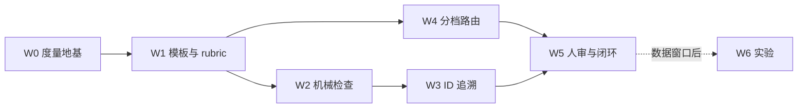

# 设计阶段硬化：把已有门禁延伸到技术方案（2026-10 提案）

## TL;DR

design 阶段是 forge 的短板：默认只给 advisory，模板只有 5 节，验收条目没有需求 ID，doclint 也不认识设计文档。本提案共 25 个工作项，分 7 个工作包（W0–W6），按 3 批交付。做法是以现有机制为主（doclint DocType、reqclean、PlanScope/ScopeDrift、AcceptanceCriterion、artifact-chain 分档、checklog 审计），新逻辑集中在 4 个新文件里（reqtrace、designcheck、designtier、approvaldigest）。每项先以 advisory 落地，攒够度量再决定是否升为门禁。刻意不做三件事：全量强制 EARS、每个任务都拆三份文件、让 LLM 评分单独构成门禁。

## 问题与目标

现状证据（锚点钉在基线 `e896ebc`）：

| 断点 | 证据 |
|---|---|
| design 阶段默认 advisory，指令只有一句话；`chain-init` 只把 spec 提升为人审 | `internal/artifactchain/artifactchain.go:150`@e896ebc，`internal/clitask/task_chaininit.go`@e896ebc |
| 技术方案模板 5 节，缺 Non-goals、接口、触点、不变量、Open Questions、元数据头 | `skills/doc-generator/references/template-tech-plan.md`@e896ebc |
| 验收条目无 ID、无回链，答不出"哪条需求没被验证" | `internal/tasktypes/types.go:74`@e896ebc |
| doclint 只有 test-report、retrospective、checklist 三种类型 | `internal/doclint/rules.go:104`@e896ebc |
| rubric 对 tech-plan 只走通用四维兜底 | `skills/doc-review/references/rubric-docs.md:70`@e896ebc |
| 需求卫生扫描只覆盖 spec 阶段；没有任何检查验证方案引用的路径和符号是否存在 | `internal/taskpipeline/reqclean.go:59`@e896ebc |
| doc-generator 的触发词缺"技术方案""设计文档" | `skills/doc-generator/SKILL.md` frontmatter@e896ebc |
| 分档全凭 agent 自觉：plan-first 只检查"有没有方案"，不判断"该不该有、该多重" | `internal/taskpipeline/executor.go:465`@e896ebc |

外部证据（来源见文末「证据来源」）：
- AI 生成的架构组件常对、连线常错：关系准确度 Edge F1 ≤ 0.18；约 33% 的内容在需求里找不到依据；架构关键需求覆盖率 49–58% [E1]。
- 计划只有在正确或被验证时才提升代码质量 [E2][E3][E4]。
- 同时下达的指令条数越多，遵循越差：500 条时最好的前沿模型准确率也只有 68% [E5]。
- 给 agent 加上下文文件（AGENTS.md）总体不提升任务成功率，推理成本平均增加 20% 以上；该文附录 B 实测文件长度与成功率、成本都无明显相关 [E6]。（更正 2026-10-15：原文把两条拼成"上下文文件越长成本越高"，E6 不支持"越长越贵"，已拆开。）
- 完整 SDD 流程在中等需求上约 10 倍开销，产出质量无提升（n=1 实测）[E7]。
- 业界判断方案该多重，靠的是"规则清单 + agent 建议 + 人否决 + 事后用 diff 兜底"[E8][E9]。

目标：让「方案对不对」的一部分变成机械可答——引用是否存在、需求是否被验证、改动是否在方案范围内、方案该写多重。

## 原则（本提案全部改动不得违反）

1. **复用优先于新增**：先改模板、规则表和现有检查的作用域；新命令面净增 0。
2. **先 advisory，后门禁**：每项先观察一个度量窗口（30 天或 25 个任务，先到为准），由数据决定是否升档。唯一例外是用户自己把产物链显式升档（见 W3.3）。
3. **门禁看风险，不看篇幅**：档位由风险信号决定；评分沿用 rubric 现有的长度中性规则，不奖励长文。
4. **逃生舱照旧**：所有新检查都能通过 env 关闭，每次逃生都落 checklog 审计行。
5. **不做存量回填**：forge 自己的旧设计文档不改造，新文档才用新模板。

## Non-goals

- **不全量强制 EARS/Gherkin**：没有对照研究证明记法本身提升代码正确率；只强制"禁模糊词 + 每条需求写清触发与响应"。
- **不要求每个任务拆三文件**：三文件只用于完整方案（full）档。
- **不让 LLM 评分单独构成门禁**：保持现有"L1 机械规则 + L2 人工落分"的分工。
- **不回填旧文档**：`docs/design/` 下现有 27 份文档不改造。
- **数据窗口前不把 W2–W5 的默认行为升为阻断**；用户显式把产物链 spec/design 升到 rubric 及以上时，需求覆盖检查按其选择阻断（首发即 blocked，compat-commitments §二②）。

## 工作项

规模标记：S ≤ 半天 · M 1–2 天 · L 3 天以上。

### W0 度量地基

| # | 做什么 | 触点 | 规模 |
|---|---|---|---|
| 0.1 | checklog 新增 `design-tier` 行：声明档位、推导档位、最终档位、下调理由、命中的触发器 | `internal/taskpipeline/designtier.go`，`internal/taskpipeline/executor.go` | S |
| 0.2 | `plan_conversion` 增加按档位的跳过率、否决率 | `internal/taskpipeline/plan_conversion.go`，`internal/clitask/task_conversion.go` | S |
| 0.3 | 上线前跑 `forge eval harness-audit` 落基线 | `evals/harness-audit-6d5e-baseline-202610.json` | S |

### W1 模板与评审标准

| # | 做什么 | 触点 | 规模 |
|---|---|---|---|
| 1.1 | 技术方案模板重写为三档：直接改不写方案；小方案为单文件骨架；完整方案拆需求/设计/任务三文件并人工批准 | `skills/doc-generator/references/template-tech-plan.md` | M |
| 1.2 | 触发词补"技术方案 / 设计文档 / design doc / tech plan / 实现方案" | `skills/doc-generator/SKILL.md` | S |
| 1.3 | 默认链 design 阶段的指令指向模板章节 | `internal/artifactchain/artifactchain.go:DefaultChain` | S |
| 1.4 | dev-workflow 考古结论落成方案「触点」；evidence-based-proposal 的核查结论写进方案 | `skills/dev-workflow/SKILL.md`，`skills/evidence-based-proposal/SKILL.md` | S |
| 1.5 | rubric 新增技术方案 Critical 行 | `skills/doc-review/references/rubric-docs.md` | S |
| 1.6 | 分档决策表写进 dev-workflow；标准变更白名单；拿不准上调一档 | `skills/dev-workflow/SKILL.md` | S |

### W2 机械检查（advisory）

| # | 做什么 | 触点 | 规模 |
|---|---|---|---|
| 2.1 | doclint 新增 `design` DocType：TL;DR 前置，Non-goals 与验证必有，按 frontmatter `tier` 分档篇幅；观察窗口内全部 advisory | `internal/doclint/rules.go`，`internal/doclint/lint.go` | M |
| 2.2 | 需求卫生扫描扩到 design 产物；Open Questions 未关闭项逐条报 | `internal/taskpipeline/reqclean.go` | S |
| 2.3 | 方案事实核查 `forge task artifact --check [--file]`：路径、`file:line`、Go 符号、Go 模块（对照 go.mod）是否存在；`new:` / `new-dep:` 行豁免；落 `design-check` 行 | `internal/taskpipeline/designcheck.go`，`internal/clitask/task_chain.go` | M |
| 2.4 | 登记 design 产物时触点写入 PlanScope（手工 `--scope` 优先） | `internal/taskpipeline/designcheck.go:ApplyDesignTouchpoints`，`internal/clitask/task.go` | S |

### W3 需求 ID 追溯

| # | 做什么 | 触点 | 规模 |
|---|---|---|---|
| 3.1 | `AcceptanceCriterion` 增加 `Traces []string`；前缀与行尾两种写法（D1）；同一道题多处追溯取并集；条目身份仍是 Run/Expected/Assertions 三元组 | `internal/tasktypes/types.go`，`internal/taskpipeline/acceptance.go`，`internal/taskpipeline/acceptance_artifact.go`，`internal/taskpipeline/reqtrace.go` | M |
| 3.2 | 需求覆盖表（已验证 / 未验证 / 孤儿），`artifact --verify` 与 verify-acceptance 输出 | `internal/taskpipeline/reqtrace.go`，`internal/clitask/task_gate.go` | M |
| 3.3 | 交付报告列出覆盖；complete 默认 advisory，产物链 spec/design ≥ rubric 时阻断（`FORGE_REQ_COVERAGE` 逃生） | `internal/clitask/task_report.go`，`internal/taskpipeline/executor.go` | S |

### W4 分档路由

| # | 做什么 | 触点 | 规模 |
|---|---|---|---|
| 4.1 | 内置硬触发器表（迁移/sql、proto/OpenAPI、鉴权目录、api/pkg/sdk、依赖文件、跨 3 个以上目录）；开工前按 PlanScope 算、交付时按实际 diff 算；项目 protocol.yml 的 design_tiers 可追加或覆盖 | `internal/taskpipeline/designtier.go`，`internal/protocol/types.go` | M |
| 4.2 | `task start --tier none\|mini\|full`；最终档位 = max(推导, 声明)；下调须 `--tier-reason` | `internal/clitask/task.go` | S |
| 4.3 | 标准变更白名单（纯文档、lock 文件、go.mod 仅 patch 升级）不触发档位 | `internal/taskpipeline/designtier.go:goModPatchOnly` | S |
| 4.4 | 事后升档：实际 diff 要求更高档且无 design 产物 → advisory | `internal/taskpipeline/designtier.go:CheckDesignTierEscalation` | S |

### W5 人审与闭环

| # | 做什么 | 触点 | 规模 |
|---|---|---|---|
| 5.1 | `artifact --approve` 前打印一屏审批摘要（TL;DR、高危步骤、Open Questions、相对上次批准的变化）；`--checked` 记录审了什么 | `internal/taskpipeline/approvaldigest.go`，`internal/clitask/task_chain.go` | M |
| 5.2 | scope-drift 把方案外改动单独标出；project-acceptance 维度 2 接 design-audit 三态判决 | `internal/taskpipeline/executor_check_verify.go`，`skills/project-acceptance/SKILL.md` | M |
| 5.3 | ADR 约束力：accepted 有约束力、取代关系双向写；模板增「取代」行 | `skills/architecture-decision-record/SKILL.md`，`skills/architecture-decision-record/templates/adr-template.md` | S |

### W6 实验与自用

| # | 做什么 | 规模 |
|---|---|---|
| 6.1 | context pack A/B：按 REQ/INV 切片生成单任务上下文，与"整份方案 + 自由探索"对比；结论出来前不做成功能 | M |
| 6.2 | forge 自己的新设计文档使用新模板与 Mermaid（不回填旧文档） | S |

## 分期与依赖



三批依次为 W0+W1、W2+W4、W3+W5；W0–W5 与 6.2 在单任务 `feat/design-stage-hardening` 内按工作包分 commit 交付。6.1 是对照实验，按原则 2 等数据窗口结束后再立项。

## 备选对比

| 方案 | 一句话描述 | 结论 |
|---|---|---|
| 本提案（推荐） | 现有门禁向 design 阶段延伸，advisory 起步 | — |
| 什么都不做 | 维持现状，方案质量靠 skill 自觉 | 否：约 33% 内容无依据 [E1]，没有任何机械检查能拦住 |
| 引入 Spec Kit/OpenSpec | 直接集成外部 SDD 工具 | 否：重复 forge 已有的验收链路，且是"瀑布回潮"批评的靶心 [E7][E10] |
| 只改模板 | 只做 W1 | 否：散文规则的遵循率随指令数下降 [E5]，必须有机械检查兜底 |

## 决策记录

**D1 需求 ID 语法：前缀与行尾两种写法并存（已定，2026-10-12）**

```
accept[REQ-3]: go test ./x -run TestA :: ok
accept: go test ./x -run TestA :: ok  #REQ-3 #REQ-4
```

解析契约：
- 行尾只认以 `#(REQ|NFR|INV)-<数字>` 开头、空格分隔、位于行末的连续标记；其余 `#` 原样保留在命令或期望文本里，避免误吞 shell 注释和期望文本中的 `#`。
- 剥离标记后再拆 `::`，Expected 里不会残留 `#REQ-3`。
- 两种写法同时出现时取并集去重。

**D2 两个"design"skill 收回核心（已定，2026-10-12）**
- design-audit 是"设计文档 vs 代码落地"的三态审计，与前端无关。
- design-artifact-standards 的 6 份环节清单里，5 份（需求、API、数据库、后端、测试方案）是通用方案设计标准，只有 phase-frontend 属于前端。
- 2026-09 拆包时按名字里的"设计族"整体移出（`docs/plans/feature-focus-2026-09.md` §2.1），拆包理由"Go 项目零触发"只对前端 skill 成立。
- 落地：两者整体收回核心 `skills/`。phase-frontend 随 skill 一起收回、不拆出——审查期加载表按 `design-artifact-standards/references/phase-<环节>.md` 寻址（`internal/skillintegrate/notes/code-review-gate.md`），拆出会断掉 frontend 环节；references 按需读取，不产生常驻路由负担。

**D3 规则表放置位置：项目质量协议 protocol.yml 的 design_tiers 段（已定，2026-10-12）**
- project policy 层（`~/.forge/projects.json`）只管"forge 是否接管该项目"，不承载规则。
- conventions profile 是机器扫描出的"项目现状描述"，`forge conventions init` 会刷新覆盖。
- protocol.yml 已承载同类的门禁调节项（如 `cross_repo_impact: advisory|required`）。做法：Go 内置默认表 + protocol.yml 追加或覆盖。

**D4 档位命名：直接改 / 小方案 / 完整方案（已定，2026-10-12）**
- 用户可见的档位按"要写多少"命名：直接改（`none`）、小方案（`mini`）、完整方案（`full`）。
- artifact-chain 的 advisory/rubric/human/hard 是"查多严"，与"写多少"是两个维度，不对用户暴露。档位到门禁强度的目标映射如下；**本批只落 advisory 提示**（原则 2），强制映射等数据窗口后再启用：

| 档位 | 要写什么 | 目标门禁强度 | 本批行为 |
|---|---|---|---|
| 直接改 `none` | 不写方案，只需验收命令 | 仅现有验收门禁 | 同目标 |
| 小方案 `mini` | 单文件方案（`skills/doc-generator/references/template-tech-plan.md`） | design 阶段 rubric：L1 lint + 事实核查 | 无 design 产物且无 plan 时 implement 给 advisory |
| 完整方案 `full` | 需求、设计、任务三文件 + 备选与取舍 | design 阶段 human：人工批准绑定哈希 | 无 design 产物且无 plan、或 design 未批准时 implement 给 advisory |

## 风险与高危步骤

- 两个 skill 从扩展包移回核心（`git mv`）：已装 forge-design 包的宿主会同时看到核心与包内旧副本，直到用户升级扩展包；包内已删除，下个版本即收敛。
- 新增一个阻断位点（W3.3），只在用户显式升档的链上生效，逃生 `FORGE_REQ_COVERAGE=disable`。

## 验证与回滚

回滚：三处新增检查分别可用 `FORGE_REQ_COVERAGE=disable`、删除 protocol.yml 的 design_tiers、不登记 design 产物关闭；状态字段只增键，回退版本后旧代码忽略新键。总验收（verify-acceptance 实跑口径；裸命令 = 退出码 0 判定）：

```accept
go test ./internal/doclint/ -run TestDesignDocType
go test ./internal/taskpipeline/ -run TestParseAcceptanceTraces
go test ./internal/taskpipeline/ -run TestRequirementCoverage
go test ./internal/taskpipeline/ -run TestDesignCheck
go test ./internal/taskpipeline/ -run TestTouchpointsPlanScope
go test ./internal/taskpipeline/ -run TestDesignTier
go test ./internal/taskpipeline/ -run TestReqHygieneDesignStage
go test ./internal/taskpipeline/ -run TestPlanConversionByTier
go test ./internal/clitask/ -run TestApproveDigest
go test ./skills/
go test ./...
go vet ./...
```

度量：

| 指标 | 定义 | 期望方向 |
|---|---|---|
| M1 幻觉拦截数 | design-check 命中的不存在路径、符号或依赖条数（需人工抽检确认为真阳性） | 上线初期 > 0；之后随模板改善下降 |
| M2 未验证 REQ 数 | 覆盖表"未验证"栏，取每个任务完成时的值 | 下降 |
| M3 事后升档率 | 4.4 命中数 / 完成任务数 | 下降（说明事前分档变准） |
| M4 否决率 / 跳过率 | 各档位下档位被带理由下调、被跳过的比例 | **持续上升 = 门禁太重**，改门禁不改用户 |
| M5 返工轮次 | 沿用现有 rework_rounds | 下降 |
| 护栏 | 各档位方案的平均行数不上升；门内耗时不上升 | 越线 → 回退对应改动 |

## 证据来源

- [E1] Li et al., R2ABench: Benchmarking Requirement-to-Architecture Generation, arXiv 2604.06683 (2026) https://arxiv.org/abs/2604.06683
- [E2] Planning-Driven Programming (LPW), arXiv 2411.14503 https://arxiv.org/abs/2411.14503
- [E3] Jain et al., LLM-Assisted Code Cleaning, ICLR 2024 https://arxiv.org/abs/2311.14904
- [E4] Cemri et al., Why Do Multi-Agent LLM Systems Fail? (MAST), arXiv 2503.13657 https://arxiv.org/abs/2503.13657
- [E5] Jaroslawicz et al., IFScale: How Many Instructions Can LLMs Follow at Once?, arXiv 2507.11538 (NeurIPS 2025) https://arxiv.org/abs/2507.11538
- [E6] Evaluating AGENTS.md, ETH Zurich, arXiv 2602.11988 (ICLR 2026；按 v3 2026-09-29 核验) https://arxiv.org/abs/2602.11988
- [E7] Eberhardt, Putting Spec Kit Through Its Paces, Scott Logic (2025-11-26) https://blog.scottlogic.com/2025/11/26/putting-spec-kit-through-its-paces-radical-idea-or-reinvented-waterfall.html
- [E8] OpenSpec https://github.com/Fission-AI/OpenSpec ；Rust RFC Book https://rust-lang.github.io/rfcs/
- [E9] Meta Engineering, Diff Risk Score (2025-08-06) https://engineering.fb.com/2025/08/06/developer-tools/diff-risk-score-drs-ai-risk-aware-software-development-meta/
- [E10] Böckeler, Understanding SDD: Kiro, spec-kit, and Tessl (2025-10-15) https://martinfowler.com/articles/exploring-gen-ai/sdd-3-tools.html
