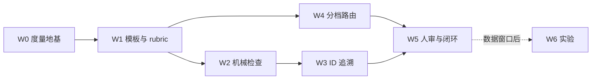

# 设计阶段硬化：把已有门禁延伸到技术方案（2026-10 提案）

## TL;DR

forge 的验收链路已领先业界，方案本体却是短板：design 阶段默认只是 advisory，模板只有 5 节，没有 ID 追溯，doclint 也不认识设计文档。本提案共 21 个工作项、分 6 期，**全部复用现有机制**（doclint DocType、reqclean、PlanScope/ScopeDrift、AcceptanceCriterion、artifact-chain 分档、checklog 审计），每项先 advisory 落地，攒够度量后再决定是否升级为门禁。刻意不做：全量强制 EARS、每个任务都拆三文件、LLM 评分单独构成门禁。

## 问题（现状证据）

| 断点 | 证据 |
|---|---|
| design 阶段默认 advisory，指令只有一句话；`chain-init` 只把 spec 提升为人审 | `internal/artifactchain/artifactchain.go:150` |
| 技术方案模板 5 节，缺 Non-goals、接口、触点、不变量、Open Questions、元数据头 | `skills/doc-generator/references/template-tech-plan.md` |
| 验收条目无 ID、无回链，答不出"哪条需求没被验证" | `internal/tasktypes/types.go:74` |
| doclint 只有 test-report、retrospective、checklist 三种类型 | `internal/doclint/rules.go:104` |
| rubric 对 tech-plan 只走通用四维兜底 | `skills/doc-review/references/rubric-docs.md:70` |
| 需求卫生扫描只覆盖 spec 阶段；没有任何检查验证方案引用的路径和符号是否存在 | `internal/taskpipeline/reqclean.go:59` |
| doc-generator 的触发词缺"技术方案""设计文档" | `skills/doc-generator/SKILL.md` frontmatter |
| 分档全凭 agent 自觉：plan-first 只检查"有没有方案"，不判断"该不该有、该多重" | `internal/taskpipeline/executor.go:465` |

外部证据摘要（详见调研报告）：
- AI 生成架构的组件连线几乎全错（Edge F1 ≤ 0.18），约 1/3 断言无依据，架构关键需求覆盖率只有 49–58%（R2ABench 2026）。
- 计划只有在正确或被验证时才提升代码质量（LPW、Jain ICLR24、MAST）。
- 文档越长遵循越差（IFScale、ETH AGENTS.md）。
- 完整 SDD 流程在中等需求上约 10 倍开销（Scott Logic）。
- 业界判断方案该多重，靠的是"规则清单 + agent 建议 + 人否决 + 事后用 diff 兜底"（OpenSpec、Rust RFC、ITIL、Devin、Meta DRS）。

## 原则（本提案全部改动不得违反）

1. **复用优先于新增**：先改模板、规则表和现有检查的作用域，新命令只在 W2 的 grounding check 引入。
2. **先 advisory，后门禁**：每项先观察一个度量窗口（30 天或 25 个任务，先到为准），由数据决定是否升档。
3. **门禁看风险，不看篇幅**：档位由风险信号决定；评分沿用 rubric 现有的长度中性规则，不奖励长文。
4. **逃生舱照旧**：所有新检查都能通过 env 关闭，每次逃生都落 checklog 审计行（沿用 conventions 的分层约定）。
5. **不做存量回填**：forge 自己的旧设计文档不改造，新文档才用新模板。

## 工作项

规模标记：S ≤ 半天 · M 1–2 天 · L 3 天以上。

### W0 度量地基（先做，作为后续所有升档决策的依据）

| # | 做什么 | 落点 | 规模 |
|---|---|---|---|
| 0.1 | 新增 checklog check：`design-tier`，记录声明档位、推导档位、最终档位和否决理由 | `internal/checklog`，executor implement 段 | S |
| 0.2 | `plan_conversion` 统计扩展到按档位的跳过率、否决率和门内耗时 | `internal/taskpipeline/plan_conversion.go` | S |
| 0.3 | 基线快照：上线前跑一次 `forge eval harness-audit`，结果落盘 `evals/` | evals | S |

### W1 模板与评审标准（只改 skill，不动 Go）

| # | 做什么 | 落点 | 规模 |
|---|---|---|---|
| 1.1 | 重写技术方案模板并分三档：直接改（none）不写方案；小方案（mini）为单文件，骨架见附录 A；完整方案（full）拆为需求、设计、任务三个文件，并要求人工批准 | `template-tech-plan.md` | M |
| 1.2 | 触发词补"技术方案 / 设计文档 / design doc / tech plan" | `skills/doc-generator/SKILL.md` | S |
| 1.3 | `DefaultChain` design 阶段的指令改为指向模板章节（一行改动） | `internal/artifactchain/artifactchain.go:151` | S |
| 1.4 | dev-workflow 2.1 的代码考古表落到方案"触点"一节；evidence-based-proposal 的核查结论写进"证据"列，不再只留在对话里 | dev-workflow、evidence-based-proposal | S |
| 1.5 | rubric 新增 tech-plan 专属 Critical 行：缺 Non-goals；缺端到端验证；缺"什么都不做"备选；数据流的边未标注同步/异步与协议；NFR 未量化；断言无指针 | `skills/doc-review/references/rubric-docs.md:70` | S |
| 1.6 | 分档决策表写进 dev-workflow：5 个风险信号（可回退性、影响面、歧义、新颖度、安全/数据）；标准变更白名单；"拿不准就上调一档" | `skills/dev-workflow/SKILL.md` | S |

### W2 机械检查（Go，全部 advisory 起步）

| # | 做什么 | 落点 | 规模 |
|---|---|---|---|
| 2.1 | doclint 新增 `design` DocType：必需章节为 TL;DR、Non-goals、验证与回滚；复用 D8 做 TL;DR 位置检查；按 frontmatter `tier` 设篇幅上限（DocType 需扩展为按档位取 MaxBodyLines） | `internal/doclint/rules.go` | M |
| 2.2 | reqclean 扫描范围扩到 design 产物：残留 `待定/TBD/[NEEDS CLARIFICATION]` 视为 Open Question 未关闭 | `internal/taskpipeline/reqclean.go` | S |
| 2.3 | **grounding check**：`forge task artifact --check [--file]`（落地时改为既有命令的新动作，命令面净增 0），核实方案中的 `file:line`、repo 路径、Go 符号和 Go 模块（对照 go.mod）是否真实存在；`new:` / `new-dep:` 行豁免；结果落 checklog `design-check` | `internal/taskpipeline/designcheck.go`，`clitask/task_chain.go` | M |
| 2.4 | 触点 → PlanScope：登记 design 产物且 PlanScope 为空时，从"触点"一节解析 glob 写入 PlanScope，直接复用 ScopeDrift 的事后比对 | `specs.go` / `task_chain.go`，`scope.go` | S |

### W3 ID 化追溯

| # | 做什么 | 落点 | 规模 |
|---|---|---|---|
| 3.1 | `AcceptanceCriterion` 增加可选字段 `Traces []string`（落地时去掉单独的 `ID` 字段：条目身份仍是 Run/Expected/Assertions 三元组，追溯只需 Traces）；解析器同时支持前缀写法和行尾写法（语法见 D1），fence 内与 `--accept` 同样适用；同一道题多处追溯取并集；旧格式行为不变 | `internal/tasktypes/types.go`，`internal/taskpipeline/acceptance.go`，`internal/taskpipeline/acceptance_artifact.go`，`internal/taskpipeline/reqtrace.go` | M |
| 3.2 | 需求覆盖表：用 spec/design 中声明的 `REQ-n` 对比 accept 的 Traces 和 Passed，输出"已验证 / 未验证 / 孤儿"三栏；`artifact --verify` 与 verify-acceptance 都输出 | `acceptance_register.go` | M |
| 3.3 | 交付报告列出未验证的 REQ（与现有 manual 档披露并列）；在 complete 阶段先 advisory，chain 设为 rubric 及以上档位时才阻断 | `acceptance_register.go`，`docgate`/complete 段 | S |

### W4 分档路由（"需求该多重"由谁判）

| # | 做什么 | 落点 | 规模 |
|---|---|---|---|
| 4.1 | 硬触发器表（确定性规则）：迁移、`*.sql`、schema、proto/openapi、公共 API 包、鉴权路径、`go.mod` 新增依赖。按 PlanScope 或触点在开工前算一次，按实际 diff 在事后再算一次；Go 内置默认表，项目可在 .forge/protocol.yml 的 design_tiers 追加或覆盖（见 D3） | 新增于 `scope.go` 旁；`internal/protocol/types.go` | M |
| 4.2 | agent 声明档位：`task start --tier none\|mini\|full`，或用方案 frontmatter；最终档位 = max(硬触发器档位, 声明档位)；往下改需要写理由，落审计行 | `internal/clitask/task.go`，`internal/taskpipeline/designtier.go` | S |
| 4.3 | 标准变更白名单（借鉴 ITIL）：依赖 patch 升级、纯文档/错别字、配置值变更，自动判为直接改（none） | 规则表同 4.1 | S |
| 4.4 | 事后升档：task-complete 时实际 diff 命中高于声明档位的硬触发器、且没有登记 design 产物 → advisory（数据窗口后再评估是否阻断） | executor complete 段 | S |

### W5 人审与闭环

| # | 做什么 | 落点 | 规模 |
|---|---|---|---|
| 5.1 | 审批摘要：`artifact --approve` 时生成一屏以内的摘要（TL;DR、高危步骤、Open Questions、相对上次批准哈希的变化）；批准记录增加"审了什么"字段 | `internal/clitask/task_chain.go`，`internal/taskpipeline/approvaldigest.go` | M |
| 5.2 | 方案与 diff 的一致性：ScopeDrift 报告里区分"方案外改动"；把 design-audit 的 LANDED/PARTIAL/MISSING 判定接入 project-acceptance 维度 2 | `scope.go`，project-acceptance | M |
| 5.3 | ADR 约束力：ADR 模板 status 增加 `superseded-by`；design 阶段 skill 增加"与 accepted ADR 冲突即视为 Critical"的检查步骤 | ADR skill/模板，rubric | S |

### W6 实验与自用

| # | 做什么 | 规模 |
|---|---|---|
| 6.1 | context pack A/B：按 REQ/INV 切片生成单个任务的上下文，与"整份方案 + 自由探索"在 forge evals 上对比一次通过率和 token 成本；结论出来前不做成功能 | M |
| 6.2 | forge 自己的新设计文档使用新模板，图改用 Mermaid（不回填旧文档） | S |

## 分期与依赖



- **第一批**：W0 + W1，约 3 天，几乎全是 skill 改动，风险最低。
- **第二批**：W2 + W4，约 5 天。
- **第三批**：W3 + W5，约 5 天。
- **W6**：6.2 随本批落地；6.1 是对照实验，按本提案原则 2 等 W0 的数据窗口结束后再立项。
- 落地方式：W0–W5 与 6.2 在单任务 `feat/design-stage-hardening` 内按工作包分 commit 交付，验收见下节。

## 总验收（verify-acceptance 实跑口径；裸命令 = 退出码 0 判定）

```accept
go test ./internal/doclint/ -run TestDesignDocType
go test ./internal/taskpipeline/ -run TestParseAcceptanceTraces
go test ./internal/taskpipeline/ -run TestRequirementCoverage
go test ./internal/taskpipeline/ -run TestDesignCheck
go test ./internal/taskpipeline/ -run TestTouchpointsPlanScope
go test ./internal/taskpipeline/ -run TestDesignTier
go test ./internal/taskpipeline/ -run TestReqHygieneDesignStage
go test ./internal/taskpipeline/ -run TestPlanConversionByTier
go test ./internal/clitask/ -run TestApproveDigest
go test ./skills/
go test ./...
go vet ./...
```

## 度量

| 指标 | 定义 | 期望方向 |
|---|---|---|
| M1 幻觉拦截数 | design-check 命中的不存在路径、符号或依赖条数（需人工抽检确认为真阳性） | 上线初期 > 0；之后随模板改善下降 |
| M2 未验证 REQ 数 | 覆盖表"未验证"栏，取每个任务完成时的值 | 下降 |
| M3 事后升档率 | 4.4 命中数 / 完成任务数 | 下降（说明事前分档变准） |
| M4 否决率 / 跳过率 | 各档位下 agent 档位被人否决、被跳过的比例 | **持续上升 = 门禁太重**，改门禁不改用户 |
| M5 返工轮次 | 沿用现有 rework_rounds | 下降 |
| 护栏 | 各档位方案的平均行数不上升；门内耗时不上升 | 越线 → 回退对应改动 |

## 刻意不做

- **不全量强制 EARS/Gherkin**：没有对照研究支持；只强制"禁模糊词 + 每条需求写清触发与响应"。
- **不要求每个任务拆三文件**：三文件只用于完整方案（full）档。
- **不让 LLM 评分单独构成门禁**：保持现有"L1 机械规则 + L2 人工落分"的分工。
- **不回填旧文档**：forge 现有 26 份 design 文档不改造。
- **不在数据窗口前把任何 W2–W5 检查升为阻断**。

## 备选对比

| 方案 | 一句话描述 | 结论 |
|---|---|---|
| 本提案（推荐） | 现有门禁向 design 阶段延伸，全部 advisory 起步 | — |
| 什么都不做 | 维持现状，方案质量靠 skill 自觉 | 否：AI 方案约 1/3 断言无依据，没有任何机械检查能拦住 |
| 引入 Spec Kit/OpenSpec | 直接集成外部 SDD 工具 | 否：重复 forge 已有的验收链路，且是"瀑布回潮"批评的靶心 |
| 只改模板 | 只做 W1 | 否：散文规则的遵循率不可靠（IFScale），必须有机械检查兜底 |

## 决策记录

**D1 需求 ID 语法：前缀与行尾两种写法并存（已定，2026-10-12）**

```
accept[REQ-3]: go test ./x -run TestA :: ok
accept: go test ./x -run TestA :: ok  #REQ-3 #REQ-4
```

解析契约：
- 行尾只认以 `#(REQ|NFR|INV)-<数字>` 开头、空格分隔、位于行末的连续标记；其余 `#` 原样保留在命令或期望文本里，避免误吞 shell 注释和期望文本中的 `#`。
- 剥离标记后再拆 `::`，Expected 里不会残留 `#REQ-3`。
- 两种写法同时出现时取并集去重。

**D2 两个"design"skill 收回核心（已定，2026-10-12）**
- design-audit 是"设计文档 vs 代码落地"的三态审计，与前端无关。
- design-artifact-standards 的 6 份环节清单里，5 份（需求、API、数据库、后端、测试方案）是通用方案设计标准，只有 phase-frontend 属于前端。
- 2026-09 拆包时按名字里的"设计族"整体移出（`feature-focus-2026-09.md` §2.1），拆包理由"Go 项目零触发"只对前端 skill 成立。
- 落地：两者整体收回核心 `skills/`。phase-frontend 随 skill 一起收回、不拆出——审查期加载表按 `design-artifact-standards/references/phase-<环节>.md` 寻址（`internal/skillintegrate/notes/code-review-gate.md`），拆出会断掉 frontend 环节；references 按需读取，不产生常驻路由负担。核心 code-review-gate 在未装扩展包的宿主上引用清单断开的问题随之修复。

**D3 规则表放置位置：项目质量协议 protocol.yml 的 design_tiers 段（已定，2026-10-12）**

原先列的两个候选都不合适：
- project policy 层（`~/.forge/projects.json`）只管"forge 是否接管该项目"（managed/declined），不承载规则。
- conventions profile（`<DataDir>/conventions/profile.json`）是机器扫描出的"项目现状描述"，`forge conventions init` 会刷新覆盖。

项目 protocol.yml（.forge/ 下的团队覆盖层或用户级 DataDir） 已经承载同类的门禁调节项（如 `cross_repo_impact: advisory|required`），是"项目质量规则"的既有归宿。做法：Go 内置默认表 + protocol.yml 追加或覆盖。

**D4 档位命名：直接改 / 小方案 / 完整方案（已定，2026-10-12）**
- 用户可见的档位按"要写多少"命名，与 Google 的 mini design doc 和 OpenSpec 的"直接改 / 写提案"一致：
  - 直接改（`none`）
  - 小方案（`mini`）
  - 完整方案（`full`）
- artifact-chain 的 advisory/rubric/human/hard 是"查多严"（门禁强度），与"写多少"是两个维度，不对用户暴露，由档位自动推导：

| 档位 | 要写什么 | 门禁强度（自动推导） |
|---|---|---|
| 直接改 `none` | 不写方案，只需验收命令 | 仅现有验收门禁 |
| 小方案 `mini` | 单文件方案（附录 A） | design 阶段 rubric：L1 lint + grounding check |
| 完整方案 `full` | 需求、设计、任务三文件 + 备选与取舍 | design 阶段 human：人工批准绑定哈希 |

## 附录 A：小方案（mini）骨架

```
---
id / status(draft|review|approved|superseded-by) / owner / ask / reviewers / tier
---
## TL;DR（≤120 字：决策 + 需要你做什么）
## 问题与目标（证据 file:line；目标可量化）
## Non-goals
## 需求与验收（REQ-n：触发→响应；每条带 accept[REQ-n] 行）
## 设计
   ### 触点（file:symbol；新文件标 new:）→ 自动写入 PlanScope
   ### 接口/契约（代码块）
   ### 数据流（mermaid；每条边标注同步/异步与协议）
   ### 不变量 INV-n（硬约束注明由哪个测试/hook 执行）
## 备选对比（表格，含"什么都不做"）
## 风险与高危步骤
## Open Questions（有阻断项时不进入实现）
## 验证与回滚（accept fence，端到端）
```
